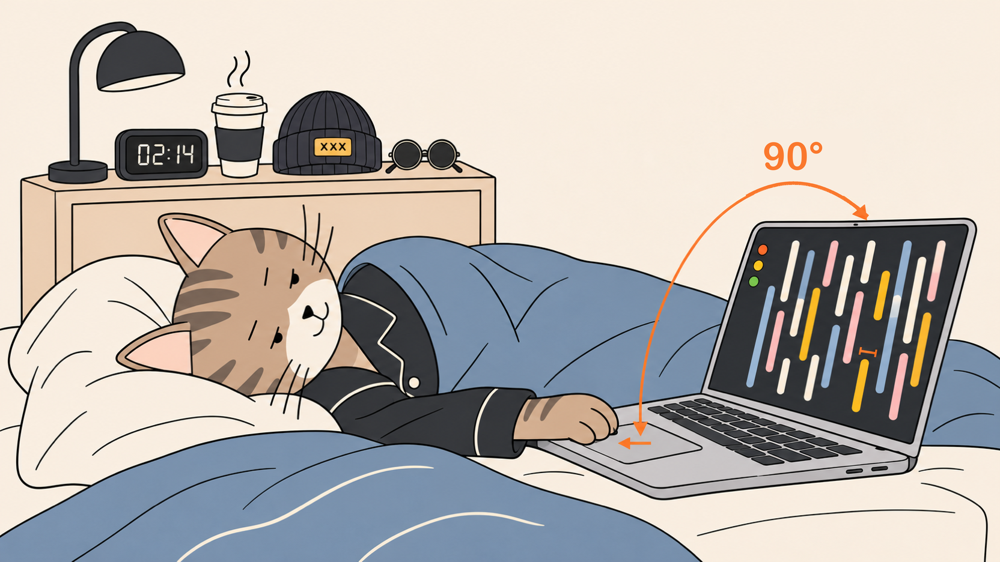
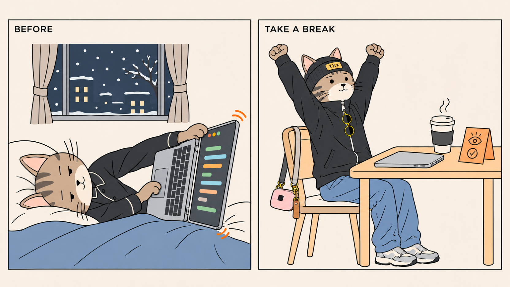
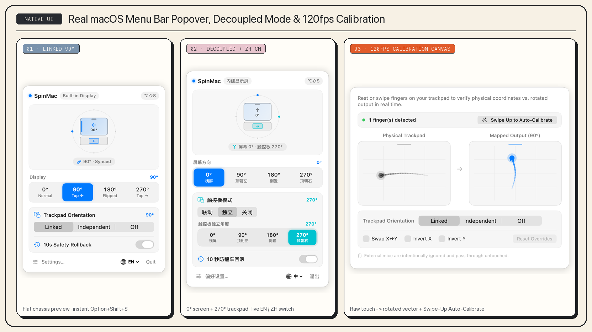
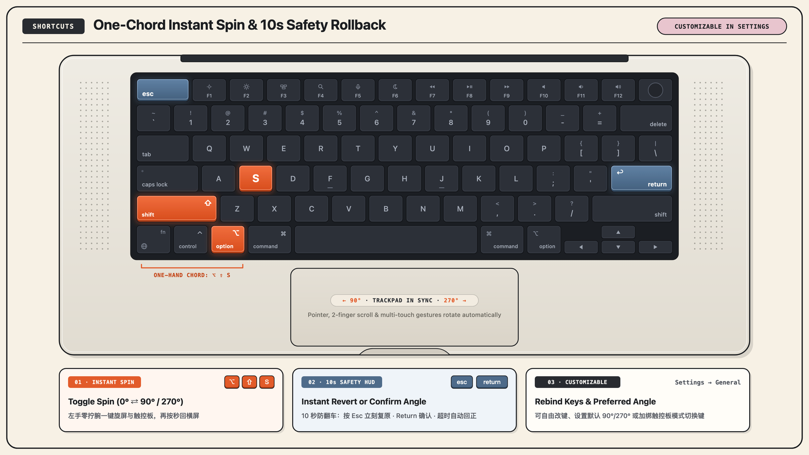
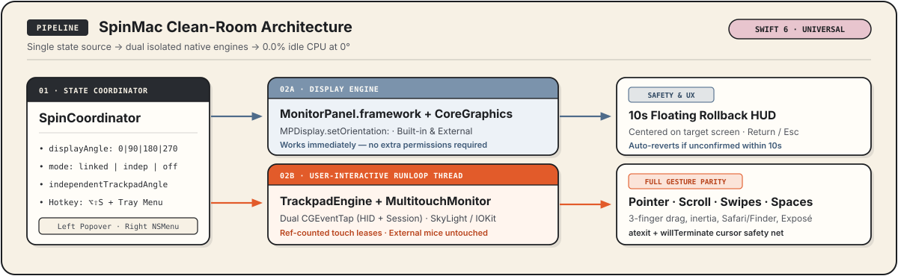
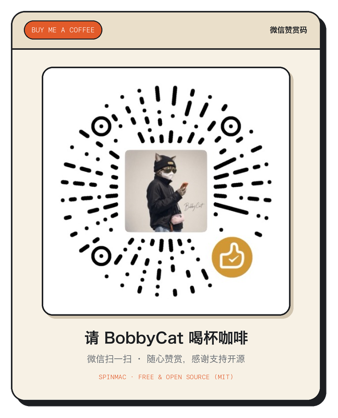

<div align="center">



<br/><br/>

# SpinMac

**Built for cold-night vibe coding in bed. Keep your MacBook flat on the mattress and spin the screen, trackpad, and every gesture to match your sideways eyes.**

Native SwiftUI & AppKit · Linked or Decoupled Orientation · Full Multi-Touch Parity · **0.0% Idle CPU**

<p>
  <a href="https://github.com/BobbyCats/SpinMac/releases/latest"></a>
  
  
  <a href="LICENSE"></a>
  <a href="https://x.com/BobbyCat2025"></a>
</p>

<p>
  <strong>English</strong> · <a href="README.zh-CN.md">简体中文</a>
</p>

</div>

---

## Why I Built This

Everyone is vibe coding nonstop right now, and I got completely hooked too. Most nights I am still messing with code past 2 AM. Now that the weather has turned cold, sitting upright at a desk late at night feels miserable. I just want to crawl under a warm blanket early with my laptop.

At first, I kept the MacBook flat on the mattress and propped my head up on one hand — within ten minutes my arm went numb and my neck ached. Next, I tried putting my head flat on the pillow and standing the MacBook up on its side edge so the screen lined up with my eyes. The flaw showed up immediately on a soft mattress: the laptop wobbles and wants to tip over constantly, and typing or using a vertical trackpad in mid-air is miserable.

So I built **SpinMac**. Keep your head relaxed on the pillow and **leave the laptop completely flat and rock-solid on the bed**, then spin only the display and trackpad in software. macOS hides Display Rotation whenever no external monitor is plugged in, and rotating only the screen leaves the trackpad fighting every swipe. With SpinMac, one shortcut (`⌥⇧S`) rotates the built-in display, the trackpad, and every multi-touch gesture together — `90°` (`Top ←`, left edge up) when lying on your left side, or `270°` (`Top →`, right edge up) when lying on your right side. You can also decouple display and trackpad angles completely.

<div align="center">
  
</div>

> **Friendly Eye-Health Reminder**
> Cold nights make bed-coding dangerously tempting, so please take this seriously: do not spend hours every night lying sideways staring at a screen. Uneven focus distance between both eyes is awful for astigmatism and eye strain, and your neck still keeps score. Use SpinMac for short cozy sessions or creative desk setups, then sit up and stretch once in a while.

---

## Download & Install

1. Grab the latest **`SpinMac-x.x.x-universal.dmg`** from [**GitHub Releases**](https://github.com/BobbyCats/SpinMac/releases/latest) (works natively on both Apple Silicon and Intel Macs, macOS 14.0+).
2. Open the `.dmg` and drag **SpinMac.app** into your **Applications** folder.
3. Launch **SpinMac** from Applications.
   - **Display rotation** works right away with **zero extra permissions**.
   - **Trackpad & multi-touch gesture rotation** uses macOS **Accessibility** and **Input Monitoring** (System Settings → Privacy & Security). Click the **Grant Access** pill inside SpinMac and it activates as soon as both are toggled on.

<details>
<summary><strong>Build from Source (Developers)</strong></summary>

Requires **macOS 14.0+** and **Swift 6.0+ / Xcode 16+**:

```bash
git clone https://github.com/BobbyCats/SpinMac.git
cd SpinMac

# Run tests, build release binary, verify en/zh-Hans localization, assemble & install to /Applications
./Scripts/build_app.sh

# Or build a Universal (arm64 + x86_64) drag-to-Applications DMG under dist/
./Scripts/package_dmg.sh
```

To preserve macOS permission grants across local rebuilds or notarize your own release DMG:

```bash
SIGN_IDENTITY="Developer ID Application: Your Name (TEAMID)" ./Scripts/build_app.sh

SIGN_IDENTITY="Developer ID Application: Your Name (TEAMID)" \
NOTARY_PROFILE="your-notary-profile" \
./Scripts/notarize.sh
```

</details>

---

## What SpinMac Does

<div align="center">
  
</div>

### 1. Roll Left, Roll Right, or Decouple Completely
- **Linked Mode (Default)** — Press `⌥⇧S` (or pick `90° / 180° / 270°` in the popover) to spin your built-in display and trackpad together. Rotating an external vertical monitor leaves your laptop's built-in trackpad safely at `0°`.
- **Independent Mode** — Set any angle pair independently. Keep your screen horizontal at `0°` while turning a sideways external Magic Trackpad to `270°`, or mix any `0° / 90° / 180° / 270°` combination.
- **Off Mode** — Rotate only the screen while completely suspending trackpad interception.

### 2. One-Chord Shortcut & 10s Safety Rollback

<div align="center">
  
</div>

- **`⌥ ⇧ S`** — Rest your left pinky on `shift`, thumb on `option`, and tap `S` to toggle between `0°` and your preferred portrait angle (`90°` or `270°`) effortlessly with one hand (zero browser or IDE conflicts). Rebindable anytime in **Settings → General**, where you can also set an optional shortcut to cycle Trackpad Mode.
- **`esc` / `return`** — Whenever you spin away from `0°`, a floating 10-second confirmation HUD appears centered on screen. Tap `esc` to snap straight back to `0°`, tap `return` to confirm immediately, or do nothing and it auto-reverts after 10 seconds.

### 3. Full Multi-Touch Gesture Parity
Everything that works upright continues working sideways:

| Input / Gesture | Rotated Behavior |
| :--- | :--- |
| **Pointer, Clicks & 3-Finger Drag** | HID-level delta rotation, multi-display virtual cursor clamping, and synchronized left/right/middle clicks |
| **2-Finger Scroll & Momentum** | Continuous scroll and inertia vectors rotated smoothly while respecting your Natural Scrolling preference |
| **2-Finger Page Swipes** | Forward and back navigation gestures aligned to visual left/right in Safari, Chrome, and Finder |
| **3/4-Finger Spaces & Mission Control** | Rewrites both `CGEvent` and underlying `IOHIDEvent` Dock-swipe vectors so Spaces, Mission Control, and App Exposé follow your fingers |
| **External Mice** | Hardware contact gating keeps USB/Bluetooth mice and discrete scroll wheels completely untouched |

### 4. Native Menu Bar Craft & 120fps Calibration
- **Left-Click Popover + Right-Click Tray Menu** — Left-click opens the native Control Center popover with a live dual-body silhouette and instant `EN / 中` bilingual toggle. Right-click opens a native macOS `NSMenu` for one-click angle switching, Trackpad Mode, Language, Settings, and Quit.
- **120fps Live Calibration & Swipe-Up Auto-Calibrate** — Open **Settings → Calibration** to inspect live raw vs. mapped finger trails on a SwiftUI `Canvas`. Unsure whether your setup is `90°` or `270°`? Click **Swipe Up to Auto-Calibrate**, swipe visually upward once, and SpinMac locks in the angle automatically.
- **Zero Background Drag & Cursor Safety Net**:
  - **0.0% Idle CPU**: At `0°` or in `Off` mode, both event taps are disabled and hardware touch callbacks stop completely via reference-counted leases.
  - **Dedicated Event Thread**: `CGEventTap` runs on an isolated `.userInteractive` `CFRunLoop` thread so UI animations never stall cursor motion.
  - **10-Second Rollback HUD**: Switching away from `0°` shows a centered confirmation HUD (`Return` to keep, `Esc` to revert immediately, auto-reverts after 10s).
  - **Unconditional Cursor Recovery**: Both `applicationWillTerminate` and a C-level `atexit` hook re-associate the hardware cursor on exit.

---

## Architecture

<div align="center">
  
</div>

### Transparency on Private macOS Frameworks
Public macOS APIs do not expose built-in display rotation or raw Dock-swipe HID subtrees, so SpinMac dynamically loads three system frameworks at runtime:
- `MonitorPanel.framework` (`MPDisplay.setOrientation:`) — built-in and external display rotation.
- `MultitouchSupport.framework` (`MTDeviceCreateList` and contact frames) — distinguishes trackpads from external mice and feeds live touch calibration.
- `SkyLight.framework` / `IOKit` (`SLEventCopyIOHIDEvent`, `SLEventSetIOHIDEvent`, `IOHIDEvent*`) — rotates multi-finger Dock and navigation gesture vectors.

Because of these private frameworks, **SpinMac is distributed on GitHub rather than the Mac App Store.** Every symbol is resolved dynamically with safe fallbacks.

---

## FAQ

<details>
<summary><strong>Will SpinMac interfere with my external mouse?</strong></summary>

No. Pointer and continuous scroll transforms only run while `MultitouchSupport.framework` reports live contact on a targeted trackpad. External USB/Bluetooth mice and discrete scroll wheels always pass through untouched.
</details>

<details>
<summary><strong>What happens when I rotate an external vertical monitor?</strong></summary>

In default **Linked** mode with **Built-in Trackpad Only** scope, rotating an external display keeps your MacBook's built-in trackpad at `0°`. If you use a sideways Magic Trackpad, switch to **Independent** mode and pick any angle you like.
</details>

<details>
<summary><strong>Can my cursor get stuck if SpinMac quits unexpectedly?</strong></summary>

No. SpinMac registers both `applicationWillTerminate` and a C-level `atexit` hook that unconditionally calls `CGAssociateMouseAndMouseCursorPosition(1)` and disables all event taps.
</details>

---

## Author, Contributing & License

Built by **BobbyCat** ([`@BobbyCat2025` on X](https://x.com/BobbyCat2025) · [GitHub](https://github.com/BobbyCats)). If SpinMac saved your MacBook from tipping over on your bed (or enabled a very cozy 2 AM coding session), come say hi on X — I share weird little tools I build for myself and the messy logs behind them.

<details>
<summary>☕ <strong>Enjoying SpinMac? Buy Me a Coffee (WeChat Tip QR)</strong></summary>
<br/>
<div align="center">
  
</div>
</details>

<br/>

Ideas, macOS compatibility reports, and PRs are welcome; see [CONTRIBUTING.md](CONTRIBUTING.md). Released under the [MIT License](LICENSE).
