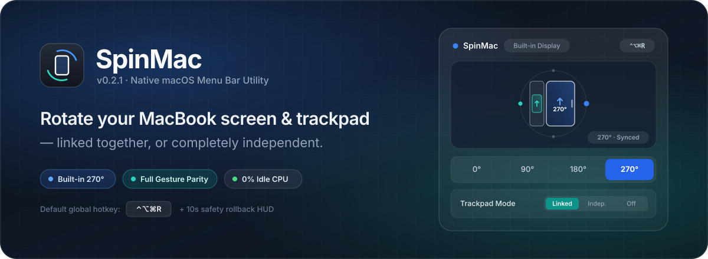

<div align="center">



<br/><br/>

# SpinMac

**Prop your MacBook sideways in bed. Spin the screen, the trackpad, and every gesture to match.**

Native SwiftUI & AppKit · Linked or Decoupled Orientation · Full Multi-Touch Parity · **0% Idle CPU**

<p>
  <a href="#quick-start"></a>
  
  
  <a href="LICENSE"></a>
</p>

<p>
  <strong>English</strong> · <a href="README.zh-CN.md">简体中文</a>
</p>

</div>

---

## The Origin Story (Yes, Really)

It started with a very modest life goal: **using a MacBook comfortably in bed.**

Sitting upright in bed ruins the whole point of being in bed. Lying flat on your back turns typing into an upper-body workout. Then one night, lying on my side, I stumbled onto peak horizontal ergonomics: **stand the MacBook upright on its side edge like an open hardcover book.** It balances rock-solid on the mattress.

One catch: macOS hides the Display Rotation dropdown whenever you aren't plugged into an external monitor. And even once you coax the screen into rotating, your trackpad stays stubbornly upright — turning a casual swipe into a spatial reasoning exam.

So I built **SpinMac** — a tiny, slightly over-engineered native macOS menu bar app that rotates **both** your MacBook's built-in display and its trackpad in one keystroke. Roll onto your right side (`270°`), roll onto your left side (`90°`), or prop a Magic Trackpad sideways next to a horizontal monitor — everything follows naturally.

> **Friendly Eye-Health Disclaimer**
> Please don't actually spend hours lying sideways staring at a laptop screen. Your eyes (and your optometrist) will not thank you for uneven viewing distances and astigmatism. SpinMac is built for brief lazy comfort and creative desk setups — not medical advice. Take breaks and sit up once in a while!

---

## What SpinMac Does

### 1. Roll Left, Roll Right, or Decouple Completely
- **Linked Mode (Default)** — Hit `⌃⌥⌘R` (or click the menu bar icon) to flip between `0°` and your favorite portrait angle (`270°` right-side down, `90°` left-side down, or `180°`). Your built-in trackpad rotates in lockstep. If you rotate an external display, your laptop's built-in trackpad automatically stays at `0°`.
- **Independent Mode** — Set the display and trackpad to completely different angles. Keep your screen at `0°` while rotating a sideways Magic Trackpad to `270°`, or mix and match any `0° / 90° / 180° / 270°` pair.
- **Off Mode** — Rotate only the screen while completely suspending trackpad interception.

### 2. Full Multi-Touch Gesture Parity
*Everything that feels natural upright should feel identical sideways.*

| Input / Gesture | Rotated Behavior |
| :--- | :--- |
| **Pointer, Clicks & 3-Finger Drag** | HID-level delta rotation + multi-display clamped virtual cursor + synchronized left/right/middle clicks |
| **2-Finger Scroll & Inertia** | Continuous scroll + momentum vectors rotated smoothly while respecting your Natural Scrolling preference |
| **2-Finger Page Swipes** | Forward/back navigation gestures rotated cleanly in Safari, Chrome, and Finder |
| **3/4-Finger Spaces & Mission Control** | Rewrites both `CGEvent` and underlying `IOHIDEvent` Dock-swipe vectors so Spaces, Mission Control, and App Exposé follow your fingers |
| **External Mice** | Hardware contact gating ensures USB/Bluetooth mice and discrete scroll wheels pass through completely untouched |

### 3. Native Menu Bar Craft & 120fps Calibration
- **Left-Click Popover & Right-Click Tray Menu** — Left-click for a clean Control Center popover with a live dual-body MacBook pose silhouette and an instant `中 / EN` language switcher; right-click the tray icon for a native macOS quick menu (`0°/90°/180°/270°`, Trackpad Mode, Language, Settings, Quit).
- **120fps Live Calibration & Swipe-Up Auto-Calibrate** — Open **Settings → Calibration** to watch real-time raw vs. mapped finger trails on a SwiftUI `Canvas`. Not sure if your side-lying setup is `90°` or `270°`? Click **Swipe Up to Auto-Calibrate**, swipe visually upward once, and SpinMac locks onto the right angle automatically.
- **Built-in Safety & Zero Background Drag**:
  - **0.0% Idle CPU**: At `0°` or in `Off` mode, both event taps are disabled and hardware touch callbacks stop completely.
  - **Dedicated Event Thread**: Runs `CGEventTap` on an isolated `.userInteractive` `CFRunLoop` thread so UI animations never stall cursor movement.
  - **10-Second Rollback HUD**: Rotating away from `0°` shows a centered translucent confirmation HUD (`Return` to keep, `Esc` to revert immediately, auto-reverts after 10s).
  - **Cursor Safety Net**: Unconditionally re-associates the hardware cursor on deactivation, tap timeout, clean quit, and `atexit`.

---

## Architecture

<div align="center">
  
</div>

### Transparency on Private macOS Frameworks
Because public macOS APIs do not expose built-in display rotation or raw Dock-swipe HID subtrees, SpinMac dynamically loads three system frameworks at runtime:
- `MonitorPanel.framework` (`MPDisplay.setOrientation:`) — native built-in and external display rotation.
- `MultitouchSupport.framework` (`MTDeviceCreateList` & contact frames) — distinguishes trackpads from external mice and drives live touch calibration.
- `SkyLight.framework` / `IOKit` (`SLEventCopyIOHIDEvent`, `SLEventSetIOHIDEvent`, `IOHIDEvent*`) — rotates multi-finger Dock and navigation gesture vectors.

For this reason, **SpinMac is distributed via GitHub rather than the Mac App Store.** Every symbol is resolved dynamically with safe fallbacks.

---

## Quick Start

### Requirements
- **macOS 14.0+** (Sonoma, Sequoia, macOS 26 Tahoe)
- **Swift 6.0+** / Xcode 16+ (to build from source)

### Build & Install

```bash
git clone https://github.com/BobbyCats/SpinMac.git
cd SpinMac

# Run unit tests, build release binary, verify en/zh-Hans localization, assemble & install to /Applications
./Scripts/build_app.sh
```

> **Developer ID Signing & Notarization (Optional):**
> To preserve macOS Accessibility & Input Monitoring grants across local rebuilds:
> ```bash
> SIGN_IDENTITY="Developer ID Application: Your Name (TEAMID)" ./Scripts/build_app.sh
> ```
> To build, notarize with `notarytool`, staple, and archive a release ZIP:
> ```bash
> SIGN_IDENTITY="Developer ID Application: Your Name (TEAMID)" \
> NOTARY_PROFILE="your-notary-profile" \
> ./Scripts/notarize.sh
> ```

### Permissions
1. **Display rotation** works immediately with **no extra permissions**.
2. **Trackpad & multi-touch gesture rotation** requires **Accessibility** and **Input Monitoring** (System Settings → Privacy & Security). Click the **Grant Access** pill inside SpinMac and it activates automatically once granted.

---

## FAQ

<details>
<summary><strong>Will SpinMac mess up my external mouse?</strong></summary>

No. Every pointer and continuous scroll transform is gated on live hardware contact from `MultitouchSupport.framework`. USB/Bluetooth mice and discrete scroll wheels always pass through untouched.
</details>

<details>
<summary><strong>What if I rotate an external vertical monitor?</strong></summary>

In **Linked** mode with **Built-in Trackpad Only** scope (default), rotating an external display leaves your MacBook's built-in trackpad at `0°`. If you use a sideways external Magic Trackpad, switch to **Independent** mode and pick any angle you want.
</details>

<details>
<summary><strong>Can my cursor ever get stuck if SpinMac quits unexpectedly?</strong></summary>

No. SpinMac registers both `applicationWillTerminate` and a C-level `atexit` hook that unconditionally calls `CGAssociateMouseAndMouseCursorPosition(1)` and disables all taps.
</details>

---

## Contributing & License

Ideas, macOS compatibility reports, and PRs are welcome — see [CONTRIBUTING.md](CONTRIBUTING.md).

Released under the [MIT License](LICENSE). Written from scratch as a clean-room native Swift project.
