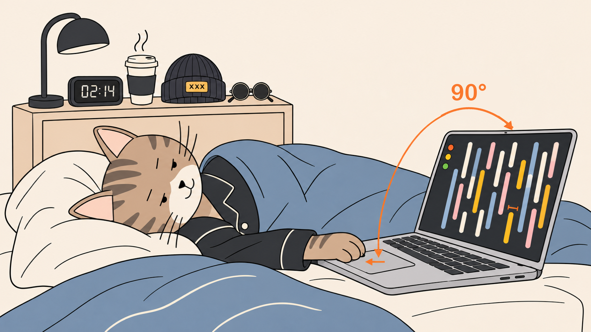
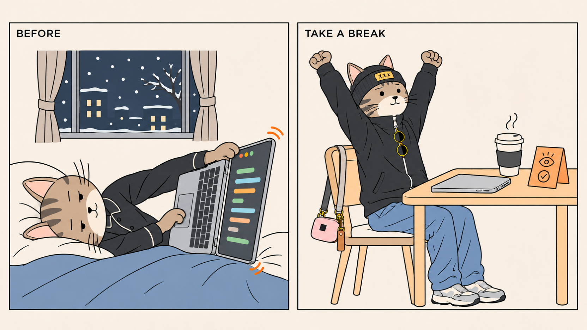
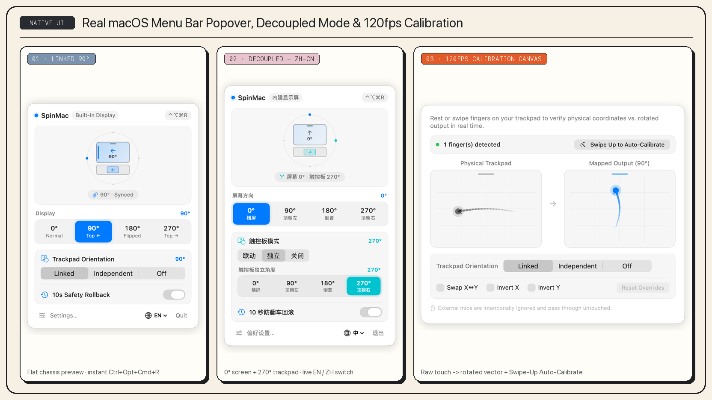
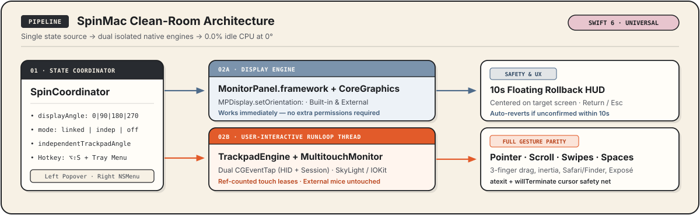
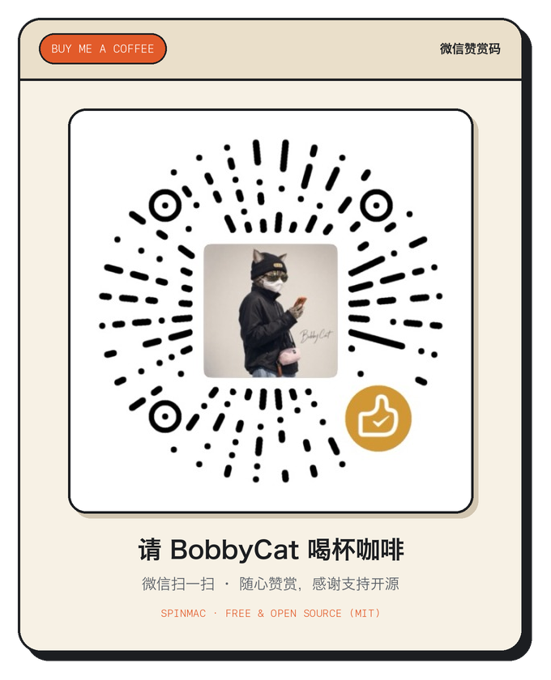

<div align="center">



<br/><br/>

# SpinMac

**天冷不想离开被窝？不用把电脑立着放，让它稳稳平摊在床上，只把屏幕、触控板和多指手势一键跟着转过来。**

纯原生 SwiftUI & AppKit · 联动或独立旋转 · 多指手势全量一致 · **静止 0.0% CPU**

<p>
  <a href="https://github.com/BobbyCats/SpinMac/releases/latest"></a>
  
  
  <a href="LICENSE"></a>
  <a href="https://x.com/BobbyCat2025"></a>
</p>

<p>
  <a href="README.md">English</a> · <strong>简体中文</strong>
</p>

</div>

---

## 为什么写了这个小工具

最近大家都在 vibe coding，我也彻底上瘾，经常一写就搞到凌晨。天冷下来以后，晚上实在不想在书桌前干坐着，只想早点钻被窝缩着玩电脑，恨不得睡觉都抱着电脑。

在床上侧躺着看电脑时，我一开始发现：只要把笔记本沿着侧面立起来，屏幕里的文字方向就能跟侧躺的眼睛对上。但真放到软绵绵的床垫上就会发现，电脑根本立不稳，稍微动一下就歪斜着要栽倒，一只手得扶着机身，另一只手还得别扭地去够竖起来的键盘和触控板，完全没法正常干活。

索性自己写了 **SpinMac**。**电脑照样老老实实平放在床上**（稳当、好打字、好摸触控板），脑袋舒舒服服平枕在枕头上，只用软件把屏幕画面和触控板方向一起转过来就行。macOS 在没接外屏时会隐藏屏幕旋转，光转屏幕不转触控板又会让光标和手势全在跟你拧着干。现在只要按一下快捷键 `⌃⌥⌘R`，内建屏、触控板连带所有多指手势同步跟着视线走：向左侧躺选 `90°`（顶朝左），向右侧躺选 `270°`（顶朝右），屏和板也可以拆开单独设角度。

<div align="center">
  
</div>

> **顺带说句实在的护眼提醒**
> 天冷窝被窝写代码确实爽，但真别学我天天熬夜侧躺看电脑。双眼焦距不对称特别容易加重散光和视疲劳，颈椎也扛不住。SpinMac 适合临时偷个懒，或者配合桌面特殊摆放姿势使用，该坐起来歇会儿的时候还是得坐起来。

---

## 下载与安装（打开就能用）

1. 前往 [**GitHub Releases**](https://github.com/BobbyCats/SpinMac/releases/latest) 下载最新的 **`SpinMac-x.x.x-universal.dmg`**（原生通用包，Apple Silicon 与 Intel 芯片 Mac 均可直接运行，需 macOS 14.0+）。
2. 双击打开 `.dmg`，把 **SpinMac.app** 拖进 **Applications（应用程序）** 文件夹。
3. 打开 **SpinMac**，顶部菜单栏会出现图标：
   - **屏幕旋转**装好就能直接用，无需额外权限。
   - **触控板与多指手势旋转**需要授予系统的 **辅助功能（Accessibility）** 和 **输入监控（Input Monitoring）**（系统设置 → 隐私与安全性）。点开 SpinMac 里的「去授权」胶囊即可跳转，勾完自动生效。

<details>
<summary><strong>从源码自己编译（开发者可选）</strong></summary>

需要 **macOS 14.0+** 和 **Swift 6.0+ / Xcode 16+**：

```bash
git clone https://github.com/BobbyCats/SpinMac.git
cd SpinMac

# 跑完单元测试、编译 Release、校验中英双语 96 项文案并安装到 /Applications/SpinMac.app
./Scripts/build_app.sh

# 或者直接打出 Apple Silicon + Intel 通用拖拽安装包 dist/SpinMac-*.dmg
./Scripts/package_dmg.sh
```

如果需要用自己的 Apple Developer ID 签名（避免本地重编后重复授权）或自签公证 `.dmg`：

```bash
SIGN_IDENTITY="Developer ID Application: Your Name (TEAMID)" ./Scripts/build_app.sh

SIGN_IDENTITY="Developer ID Application: Your Name (TEAMID)" \
NOTARY_PROFILE="your-notary-profile" \
./Scripts/notarize.sh
```

</details>

---

## SpinMac 能做什么

<div align="center">
  
</div>

### 1. 左翻身、右翻身，或者屏与板彻底解耦
- **联动模式（默认）**：按 `⌃⌥⌘R` 或点选 `90° / 180° / 270°`，笔记本内建屏与触控板同步旋转。如果连接并旋转外接显示器，笔记本自带触控板会自动保持 `0°` 不误伤。
- **独立模式**：把屏幕和触控板的方向完全拆开。比如屏幕保持 `0°` 横屏不动，桌面上侧放的外接妙控板单独旋成 `270°`，四个角度任意自由组合。
- **关闭模式**：只转屏幕，触控板事件拦截彻底休眠。

### 2. 正着能干的事，转过来照样顺手

| 输入 / 手势 | 旋转后的实际体验 |
| :--- | :--- |
| **指针移动、点击与三指拖移** | HID 层增量旋转、多屏边界钳制虚拟光标、左/右/中键点击位置精准同步 |
| **双指滚动与惯性** | 连续滚动与惯性向量同步旋转，完整保留你的系统「自然滚动」习惯 |
| **双指左右翻页** | Safari、Chrome、Finder 里的前进后退手势自动对齐眼前左右方向 |
| **三/四指切换桌面与调度中心** | 同时重写 `CGEvent` 与底层 `IOHIDEvent` 的 Dock-swipe 向量，Spaces、Mission Control、App Exposé 照常丝滑 |
| **外接鼠标与物理滚轮** | 基于 `MultitouchSupport` 实时硬件接触态门控，外接有线或蓝牙鼠标永远原样透传 |

### 3. 原生菜单栏交互与 120fps 实时校准
- **左键控制中心 + 右键快捷菜单**：左键点托盘图标弹出原生控制面板，带实时双体硬件姿态预览（屏幕和触控板箭头各自独立指向）与底栏 `中 / EN` 一键双语切换；右键点托盘图标直接展开原生 `NSMenu`，不用开面板就能切角度、换触控板模式、切语言、进设置或退出。
- **120fps 实时轨迹校准 & 「向上划一笔自动校准」**：打开 **偏好设置 → 方向校准**，SwiftUI `Canvas` 左右同屏显示物理触控坐标与映射输出。分不清当前躺姿该选 `90°` 还是 `270°` 时，点 **「向上划一笔自动校准」**，顺着眼前的“正上方”划一下就会自动识别并切过去。
- **安静不拖后腿的底层安全细节**：
  - **静止 0.0% CPU**：切回 `0°` 或关闭触控板旋转时，自动停用双 `CGEventTap` 并通过引用计数彻底停止硬件触控回调。
  - **独立高优先级事件线程**：事件拦截跑在专属 `.userInteractive` 线程，绝不因为界面动画影响光标跟手度。
  - **10 秒防翻车悬浮条**：切入竖屏或倒置时，目标屏幕正中央弹出确认条，按 `Return` 保留、按 `Esc` 立刻还原，10 秒未确认自动复原。
  - **光标安全底线**：停用、超时、退出或异常终止（`applicationWillTerminate` + `atexit`）都会无条件恢复硬件光标绑定，绝不锁死光标。

---

## 架构总览

<div align="center">
  
</div>

### 关于私有系统框架的透明说明
macOS 公开 API 没有开放内建屏旋转和底层 Dock 手势重写，SpinMac 在运行时动态加载三个系统框架：
- `MonitorPanel.framework`（`MPDisplay.setOrientation:`）：驱动内建与外接显示器原生旋转。
- `MultitouchSupport.framework`（`MTDeviceCreateList` 与触控帧回调）：区分触控板与外接鼠标，并驱动实时校准画板。
- `SkyLight.framework` / `IOKit`（`SLEventCopyIOHIDEvent`、`SLEventSetIOHIDEvent`、`IOHIDEvent*`）：重写多指切桌面与翻页手势向量。

正因为用到了这些私有框架，**SpinMac 通过 GitHub 开源分发，不上架 Mac App Store**。所有符号都在运行时动态探测加载，并保留安全降级路径。

---

## 常见问题

<details>
<summary><strong>会影响外接鼠标吗？</strong></summary>

不会。SpinMac 只有在检测到目标触控板有真实硬件触摸接触时，才会转换指针和连续滚轮，外接有线或蓝牙鼠标永远原样透传。
</details>

<details>
<summary><strong>旋转外接竖屏时，会把笔记本自带触控板也转歪吗？</strong></summary>

不会。默认的 **「联动 + 仅内建触控板」** 模式下，旋转外接显示器时笔记本内建触控板保持 `0°`。如果桌面上搭配了侧放的外接妙控板，切到 **「独立」** 模式就能单独设角度。
</details>

<details>
<summary><strong>万一 App 意外退出，光标会卡死吗？</strong></summary>

不会。SpinMac 同时注册了 `applicationWillTerminate` 和 C 层 `atexit` 兜底钩子，任何情况下退出都会无条件恢复 `CGAssociateMouseAndMouseCursorPosition(1)`。
</details>

---

## 关于作者、参与贡献与协议

作者 **BobbyCat**（X：[`@BobbyCat2025`](https://x.com/BobbyCat2025) · [GitHub](https://github.com/BobbyCats)）。如果这个小工具刚好帮你的 MacBook 稳稳平躺在床上不再栽倒，或者给你带来一点有意思的参考，欢迎来 X 找我玩，我平时常发一些自己随手搓的实用工具和踩坑实录。

<details>
<summary>☕ <strong>如果 SpinMac 帮到你了，欢迎请我喝杯咖啡（Buy Me a Coffee · 微信赞赏）</strong></summary>
<br/>
<div align="center">
  
</div>
</details>

<br/>

欢迎提交 Issue、不同 macOS 版本的实测反馈或 PR，详见 [CONTRIBUTING.md](CONTRIBUTING.md)。本项目基于 [MIT License](LICENSE) 开源。
